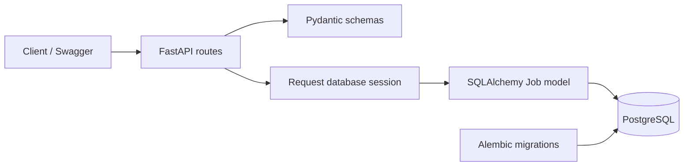

# WorkWise

A Python backend for managing jobs, built incrementally while learning backend
engineering, database design, testing, and distributed systems.

The Phase 1 checkpoint established a working single FastAPI application with
PostgreSQL persistence. The current Phase 2 checkpoint adds bounded job-list
pagination and exact company filtering. The
project was built from scratch; no Java migration is included.

## Implemented

- Job creation, listing, retrieval, replacement, partial updates, and deletion.
- Job-list pagination with validated limit/offset and deterministic ID ordering.
- Optional exact company filtering, applied before pagination.
- Optional job descriptions with distinct omitted-field and explicit-null behavior.
- Pydantic input validation and typed response models.
- SQLAlchemy ORM, request-scoped sessions, and database-generated IDs.
- Alembic schema migrations and separate runtime/migration credentials.
- PostgreSQL integration tests with transaction isolation and independent-connection
  commit verification.
- OpenAPI documentation at `/docs`.

Company is currently a text field on a job, not a separate entity or service.
Additional filters, authentication, messaging, containers, and deployment are planned.

## Stack

| Component | Technology |
|---|---|
| Runtime | Python 3.13; verified locally with 3.13.5 |
| API and validation | FastAPI and Pydantic 2 |
| Database | PostgreSQL; verified locally with 17.6 |
| Database access | SQLAlchemy 2 and Psycopg 3 |
| Migrations | Alembic |
| Tests | Pytest and HTTPX/TestClient |

Direct dependencies are pinned to the versions used locally in
`requirements.txt` and `requirements-dev.txt`. These are not a full transitive
dependency lockfile.

## Architecture



```text
main.py                App and job endpoints
schemas.py             Request and response models
models.py              SQLAlchemy table mapping
database.py            Shared engine and session dependency
settings.py            Environment configuration
migrations/            Versioned schema changes
tests/                 API, transaction, and persistence tests
docs/                  Database, migration, and testing notes
check_db.py            Read-only database connection check
baseline_db.py         Historical initial-schema adoption helper
```

## Local setup

The examples below use Windows PowerShell. Install Python and a running
PostgreSQL server first.

```powershell
git clone https://github.com/zsklav/workwise.git
cd workwise
python -m venv .venv
.\.venv\Scripts\Activate.ps1
python -m pip install -r requirements-dev.txt
Copy-Item .env.example .env
```

Edit `.env` locally with your database passwords. `DB_USER` is the runtime user;
`MIGRATION_DB_USER` is the schema-management user. `.env` is ignored by Git.

### Fresh PostgreSQL databases

These commands are for a new local installation. If you already have the
WorkWise databases and roles, keep them and skip their creation.

Open `psql` as the PostgreSQL administrator, connected to the `postgres` database.
If `psql` is not on PATH, use its full installation path. For PostgreSQL 17:

```powershell
& "C:\Program Files\PostgreSQL\17\bin\psql.exe" -h localhost -p 5432 -U postgres -d postgres
```

Run these inside `psql`, setting passwords interactively:

```sql
CREATE ROLE workwise_app LOGIN;
\password workwise_app
CREATE ROLE workwise_migrator LOGIN;
\password workwise_migrator

CREATE DATABASE workwise OWNER workwise_migrator;
CREATE DATABASE workwise_test OWNER workwise_app;
\connect workwise

GRANT CONNECT ON DATABASE workwise TO workwise_app;
GRANT USAGE ON SCHEMA public TO workwise_app;
GRANT USAGE, CREATE ON SCHEMA public TO workwise_migrator;
```

Exit with `\q`. After filling both passwords in `.env`, run migrations from
PowerShell:

```powershell
python -m alembic upgrade head
python -m alembic current
python -m alembic check
```

Then reconnect as the administrator to `workwise` and grant runtime CRUD access
to the newly created jobs table:

```sql
GRANT SELECT, INSERT, UPDATE, DELETE ON TABLE public.jobs TO workwise_app;
```

An existing manually created schema needs review and a matching baseline before
upgrades. Do not blindly stamp an unknown database. `baseline_db.py` documents
the project's original adoption of revision `0001`; it is not a generic reset
or initialization command. See [migration notes](docs/migrations.md).

### Start the API

```powershell
python -m uvicorn main:app --reload
```

- API docs: <http://127.0.0.1:8000/docs>
- Health: <http://127.0.0.1:8000/health>
- Jobs: <http://127.0.0.1:8000/jobs>

`--reload` is for local development. Database rows persist across app restarts.

## API

| Method | Path | Purpose | Success |
|---|---|---|---|
| GET | `/health` | Process health | 200 |
| GET | `/jobs` | List a page of jobs in ID order | 200 |
| GET | `/jobs/{job_id}` | Retrieve a job | 200 |
| POST | `/jobs` | Create a job | 201 |
| PUT | `/jobs/{job_id}` | Replace editable job fields | 200 |
| PATCH | `/jobs/{job_id}` | Update supplied fields only | 200 |
| DELETE | `/jobs/{job_id}` | Delete a job, no response body | 204 |

Example POST body:

```json
{
  "title": "Python Backend Intern",
  "company": "Example",
  "location": "Remote",
  "description": "Build APIs using FastAPI and PostgreSQL"
}
```

Missing jobs return `404` with `{"detail": "Job not found"}`. Invalid inputs
return `422`. Title, company, and location must be nonempty strings. Description
may be omitted or null.

PUT requires title, company, and location; omitting description clears it.
PATCH preserves omitted fields. `{"description": null}` clears description;
explicit nulls for title/company/location and unknown PATCH keys are rejected.
An empty PATCH body leaves an existing job unchanged.

`GET /jobs` accepts `limit` (default 20, minimum 1, maximum 100) and `offset`
(default 0, minimum 0). Example: `/jobs?limit=2&offset=1` skips the first row
and returns up to two jobs. Offsets count rows, not job IDs. The response
remains a JSON array. Invalid pagination values return 422; an offset beyond
the available rows returns an empty array. The default response is now bounded
at twenty rows, so clients must request subsequent pages for larger datasets.

Add `company` for an exact, case-sensitive company-name filter, for example
`/jobs?company=WorkWise&limit=2&offset=1`. Filtering happens in PostgreSQL before
pagination: offset counts matching rows. Omit company for all companies, or
receive an empty array if nothing matches. `company=` is invalid (422). Quotes,
percent signs, and underscores are treated as literal characters, not SQL or
wildcard syntax. Company values are passed as bound SQL parameters.

## Tests

```powershell
python -m pytest -v
```

Tests explicitly use `workwise_test`, applying Alembic migrations through a
shared test connection before running. The runtime role owns this separate test
database, enabling test setup without widening its development permissions.
The jobs table must start empty; existing rows are not silently deleted.

Most cases roll back their changes, including ORM commits through savepoints.
A separate persistence case uses real commits, checks independent connections,
and removes only its uniquely marked test row. Tests are designed for sequential
execution, not parallel workers.

Last verified checkpoint: **45 tests passed** on 2026-10-21. The learner also
verified that a created job remains available after restarting Uvicorn.

## Current scope and next steps

This is a learning checkpoint, not a production deployment. APIs currently have
no authentication or ownership checks, and concurrency conflict detection has
not been implemented. Offset pagination is intended for this initial stage;
large offsets and changes between page requests need later evaluation.

Next: additional filters, a company entity and relationships, authentication
and authorization, then packaging and deployment. Messaging, resilience, and
distributed tracing will follow concrete business workflows.

## Engineering notes

- [Database behavior and API contracts](docs/database.md)
- [Migration history and baseline verification](docs/migrations.md)
- [Testing setup, guarantees, and limitations](docs/testing.md)
