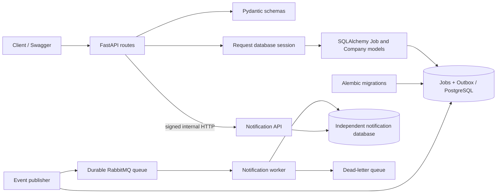
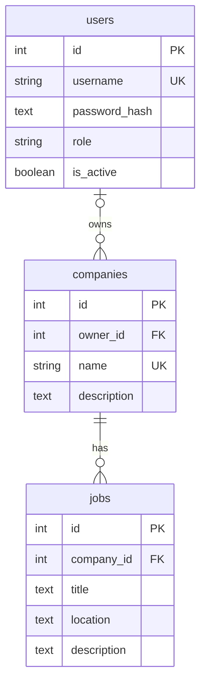

# WorkWise

A job-board backend built with FastAPI and PostgreSQL. It covers the parts a real
service needs around the CRUD: login with rotating tokens, ownership rules,
safe concurrent edits, an event pipeline, monitoring, backups and CI.

**Status:** all tests pass in CI. A Render free-tier blueprint is ready, but the
service has not been deployed yet, so there is no live URL.

## Highlights

| Area | What is built |
|---|---|
| API | Jobs, companies, applications, search with filters and sorting, `/v1` prefix, OpenAPI docs at `/docs` |
| Auth | Argon2 passwords, JWT access tokens, single-use refresh tokens, logout everywhere, password reset by email, roles (member, admin) |
| Safe writes | Version checks on every update (409 on stale edits), idempotency keys for retried creates, soft delete with admin restore |
| Data | Alembic migrations, separate runtime and migration database users, backup and restore drills |
| Events | Transactional outbox, RabbitMQ publisher and worker, retries, dead-letter queue, replay, in-app inbox |
| Operations | JSON logs, Prometheus metrics, Grafana dashboards, OpenTelemetry traces, retention tools, per-IP rate limit |
| Quality | 450+ PostgreSQL integration tests, ruff, dependency audit and coverage in CI, Docker smoke and failure demos |

## Quick start

```bash
cp .env.example .env            # then set real passwords and a 32+ character JWT_SECRET
python -m venv .venv && .venv/bin/pip install -r requirements-dev.txt
python -m scripts.database.migrate
python -m uvicorn workwise.api.main:app --port 8000
```

This needs a running PostgreSQL with the two database roles created first (see
[Fresh PostgreSQL databases](#fresh-postgresql-databases)). Then open `http://127.0.0.1:8000/docs`. The full Windows and Docker steps are in
[Docker setup](#docker-setup) and [Local setup](#local-setup). Request examples are
under [API](#api).

## Implemented

### API and data
- Job and company CRUD with validated pagination, exact company filter, and search (`q` on title, description and location).
- Job salary range, remote flag and job type, with filters and `sort`; total count in `X-Total-Count`.
- `/v1` API prefix. The old unprefixed paths stay as hidden aliases.
- Soft delete for jobs: hidden but kept with their applications. Admins can list and restore them, and a retention command purges old ones.
- Private job applications with owner and admin review, valid status transitions and version conflicts.
- PDF resume upload on local storage, with controlled download for the applicant, company owner and admins.
- Companies own their jobs through a foreign key. Responses include the read-only company name.

### Security
- Signup and login with Argon2 hashing, expiring JWTs, rotating refresh tokens and account-wide logout.
- Password reset by email with single-use, expiring, hashed tokens and a pluggable sender (off by default).
- Member and admin roles, company ownership, and an authorization check on every write.
- Per-IP rate limit on every route except `/health`, `/ready` and `/metrics`, shared by all instances through PostgreSQL.
- Trusted-proxy handling for `X-Forwarded-For`, opt-in CORS and baseline security headers.
- Least-privilege database users and separate RabbitMQ identities for publishing, consuming and replay.

### Reliability
- Version-checked updates and deletes (409 on stale edits) and optional idempotency keys with 24-hour replay.
- Transactional outbox for `job.created.v2`, confirmed publishing, manual acknowledgements, bounded retries, DLQ and operator replay.
- Independent notification database and API with an authenticated inbox and idempotent read markers.
- Snapshot-consistent backups and isolated restore drills that compare data, schema and permissions.
- Docker failure demos run in CI: broker outage, offline worker, database outage and recovery. Optional HAProxy gateway with two instances.

### Observability and delivery
- JSON request logs with request IDs, bounded latency and error metrics, admin-only `/metrics`, and `/ready` separate from `/health`.
- Optional Prometheus and Grafana stack with alert rules, and OpenTelemetry traces across HTTP, outbox, publisher, worker and inbox (Jaeger UI).
- Repeatable HTTP and SQL performance reports with measured index tuning.
- GitHub Actions: ruff, dependency audit, PostgreSQL tests with coverage, image build and HTTP container tests.

See [distributed systems and failure demos](docs/distributed-systems.md) for the event flow,
[password reset and resume upload](docs/password-reset-and-resume.md) for those two features, and the
[Render deploy guide](docs/deploy-render.md) (`render.yaml`, not yet deployed).

## Stack

| Component | Technology |
|---|---|
| Runtime | Python 3.13; verified locally with 3.13.5 |
| API and validation | FastAPI and Pydantic 2 |
| Database | PostgreSQL; verified locally with 17.6 |
| Database access | SQLAlchemy 2 and Psycopg 3 |
| Migrations | Alembic |
| Tests | Pytest and HTTPX/TestClient |
| Security | pwdlib/Argon2 and PyJWT |
| Messaging | RabbitMQ and Pika; separate PostgreSQL notification state |
| Tracing | OpenTelemetry OTLP/HTTP and Jaeger |

Direct dependencies are pinned to the versions used locally in
`requirements.txt` and `requirements-dev.txt`. These are not a full transitive
dependency lockfile.

## Architecture





```text
workwise/                    Application package
  api/                       FastAPI assembly, dependencies, schemas
    routes/                  Auth, companies, jobs, notifications, operations
  core/                      Configuration, security, logging, tracing
  db/                        Jobs database models and sessions
  messaging/                 Broker, events, publisher, worker, DLQ replay
  notifications/             Internal inbox API, contracts, storage, migration
  cli/                       Admin creation and database inspection tools
scripts/
  database/                  Jobs and notification migration runners
  docker/                    Private Docker configuration helper
  smoke/                     HTTP, distributed recovery, inbox/tracing demos
tests/                       Grouped to match application responsibilities
migrations/                  Jobs Alembic history
docker/                      PostgreSQL initialization scripts
docs/                        Architecture, operations and learning notes
.github/workflows/           PostgreSQL and Docker CI
main.py                      Compatibility entry point
Dockerfile, compose.yaml     Container build and local stack
```

See [project structure](docs/project-structure.md) for module responsibilities and commands.

## Docker setup

Install/start Docker Desktop with Linux containers first. On a fresh clone,
generate a separate private configuration once, then start the stack:

```powershell
python -m scripts.docker.create_env
docker compose --env-file .env.docker up --build --detach --wait
```

If `.env.docker` already exists, run `python -m scripts.docker.create_env --add-missing`
to append new broker/worker keys while preserving existing credentials.
For an already-running stack, follow the [controlled inbox/tracing upgrade](docs/notifications-tracing.md#schema-upgrades-and-rollout)
to stop old consumers before enabling v2 events.
Docker uses separate database volumes, independent of the native
PostgreSQL setup below. Existing local jobs are not copied into it. Your native
API can keep using port 8000; Docker docs are at <http://127.0.0.1:8001/docs>.

Compose waits for PostgreSQL health, runs migrations and runtime grants, then
starts the API as UID 10001. The API receives runtime credentials only; migration
credentials are restricted to operator services. To create a Docker admin:

```powershell
docker compose --env-file .env.docker run --rm admin
```

The tool privately prompts for a password for `workwise_admin`. Signup/Authorize
also work normally for members in this fresh stack. To stop while retaining data:

```powershell
docker compose --env-file .env.docker down
```

Keep `.env.docker` together with the volume: initialization passwords only apply
when the PostgreSQL volume is empty. See [Docker and CI notes](docs/docker-ci.md)
for upgrades, isolation, and verification details.

## Local setup

The examples below use Windows PowerShell. Install Python and a running
PostgreSQL server first.

```powershell
git clone https://github.com/zsklav/workwise.git
cd workwise
python -m venv .venv
.\.venv\Scripts\Activate.ps1
python -m pip install -r requirements-dev.txt
Copy-Item .env.example .env
```

Edit `.env` locally with your database passwords. `DB_USER` is the runtime user;
`MIGRATION_DB_USER` is the schema-management user. `.env` is ignored by Git.
Generate a signing secret locally and put it in `JWT_SECRET` in `.env`:

```powershell
python -c "import secrets; print(secrets.token_urlsafe(48))"
```

Keep this value private and stable across restarts. The API rejects missing,
short, or example placeholder secrets. Access tokens expire after 30 minutes
by default (`ACCESS_TOKEN_EXPIRE_MINUTES`). Migration commands do not require
the JWT configuration.

### Fresh PostgreSQL databases

These commands are for a new local installation. If you already have the
WorkWise databases and roles, keep them and skip their creation.

Open `psql` as the PostgreSQL administrator, connected to the `postgres` database.
If `psql` is not on PATH, use its full installation path. For PostgreSQL 17:

```powershell
& "C:\Program Files\PostgreSQL\17\bin\psql.exe" -h localhost -p 5432 -U postgres -d postgres
```

Run these inside `psql`, setting passwords interactively:

```sql
CREATE ROLE workwise_app LOGIN;
\password workwise_app
CREATE ROLE workwise_migrator LOGIN;
\password workwise_migrator

CREATE DATABASE workwise OWNER workwise_migrator;
CREATE DATABASE workwise_test OWNER workwise_app;
\connect workwise

GRANT CONNECT ON DATABASE workwise TO workwise_app;
GRANT USAGE ON SCHEMA public TO workwise_app;
GRANT USAGE, CREATE ON SCHEMA public TO workwise_migrator;
```

Exit with `\q`. After filling both passwords in `.env`, run migrations from
PowerShell:

```powershell
python -m alembic upgrade head
python -m alembic current
python -m alembic check
```

Then reconnect as the administrator to `workwise` and grant runtime access
to the newly created tables:

```sql
GRANT SELECT, INSERT, UPDATE, DELETE ON TABLE public.jobs TO workwise_app;
GRANT SELECT, INSERT, UPDATE, DELETE ON TABLE public.companies TO workwise_app;
GRANT SELECT, INSERT ON TABLE public.users TO workwise_app;
GRANT SELECT ON TABLE public.alembic_version TO workwise_app;
GRANT SELECT, INSERT, UPDATE ON TABLE public.outbox_events TO workwise_app;
```

An existing manually created schema needs review and a matching baseline before
upgrades. Do not blindly stamp an unknown database. `workwise/cli/baseline_db.py` documents
the project's original adoption of revision `0001`; it is not a generic reset
or initialization command. See [migration notes](docs/migrations.md).

### Start the API

```powershell
python -m uvicorn workwise.api.main:app --reload --no-access-log --no-proxy-headers
```

- API docs: <http://127.0.0.1:8000/docs>
- Health: <http://127.0.0.1:8000/health>
- Jobs: <http://127.0.0.1:8000/jobs>

`--reload` is for local development. Database rows persist across app restarts.
`--no-access-log` avoids duplicate raw URL logs; WorkWise emits its own JSON
request records without query strings, credentials, or bodies. Docker already
uses this flag. Responses include a new `X-Request-ID` that matches their log.

## API

Health and job/company reads are public. All job/company writes require a
bearer token. Members manage their own companies and those companies' jobs;
admins may manage any company/job. Missing/invalid credentials return 401;
authenticated callers without permission receive 403. Moving a job requires
permission on both its current company and destination company.

| Method | Path | Purpose | Success |
|---|---|---|---|
| GET | `/health` | Process health | 200 |
| GET | `/ready` | Database reachable and at the expected schema revision | 200 |
| GET | `/metrics` | Prometheus HTTP metrics; admin bearer token required | 200 |
| GET | `/v1/jobs` | Search and filter jobs: `q`, `company`, `company_id`, `remote`, `job_type`, `min_salary`, `sort`, `limit`, `offset`; total in `X-Total-Count` | 200 |
| GET | `/v1/jobs/{job_id}` | Retrieve a job | 200 |
| POST | `/v1/jobs` | Create a job | 201 |
| PUT | `/v1/jobs/{job_id}` | Replace editable job fields | 200 |
| PATCH | `/v1/jobs/{job_id}` | Update supplied fields only | 200 |
| DELETE | `/v1/jobs/{job_id}?version=N` | Soft-delete a job (applications kept) | 204 |
| GET | `/v1/jobs/deleted` | Admin only: soft-deleted jobs, newest first | 200 |
| POST | `/v1/jobs/{job_id}/restore?version=N` | Admin only: undo a soft delete | 200 |
| POST | `/v1/jobs/{job_id}/applications` | Apply to a job | 201 |
| GET | `/v1/jobs/{job_id}/applications` | Company owner or admin: list applications | 200 |
| GET | `/v1/applications/mine` | Your applications | 200 |
| GET / PATCH | `/v1/applications/{id}` | Read or review an application | 200 |
| GET | `/v1/applications/{id}/resume` | Applicant, company owner or admin: download the resume | 200 |
| PUT / GET / DELETE | `/v1/resume` | Upload (PDF), download or remove your resume | 200 / 204 |
| POST / GET | `/v1/companies` | Create a company, or list a page of companies | 201 / 200 |
| GET / PUT / PATCH / DELETE | `/v1/companies/{id}` | Read, replace, update or delete a company with no jobs | 200 / 204 |
| POST | `/v1/auth/signup` | Register a member (optional email) | 201 |
| POST | `/v1/auth/login` | Password-grant form login, returns access and refresh tokens | 200 |
| POST | `/v1/auth/refresh` | Rotate a refresh token | 200 |
| POST | `/v1/auth/logout` | Sign out all sessions | 204 |
| GET | `/v1/auth/me` | The authenticated user | 200 |
| PUT | `/v1/auth/me/email` | Set your email (current password required) | 200 |
| POST | `/v1/auth/password-reset/request` | Email a reset link; same answer for unknown addresses | 202 |
| POST | `/v1/auth/password-reset/confirm` | Set a new password with the link token | 204 |
| GET | `/v1/notifications` | Your inbox | 200 |
| PATCH | `/v1/notifications/{event_id}/read` | Mark an item read | 200 |

Every `/v1` path also answers without the prefix. Over the rate limit the API returns `429` with `Retry-After`.

### Example requests

All paths also work under `/v1`, which is the documented form. The unprefixed
paths are hidden aliases.

```bash
BASE=http://127.0.0.1:8001

# Sign up and log in
curl -X POST $BASE/v1/auth/signup -H 'Content-Type: application/json' \
  -d '{"username":"alice","password":"a long passphrase 2026"}'
TOKEN=$(curl -s -X POST $BASE/v1/auth/login -d 'username=alice&password=a long passphrase 2026' | jq -r .access_token)

# Create a company, then a remote job in it
curl -X POST $BASE/v1/companies -H "Authorization: Bearer $TOKEN" -H 'Content-Type: application/json' \
  -d '{"name":"Acme"}'
curl -X POST $BASE/v1/jobs -H "Authorization: Bearer $TOKEN" -H 'Content-Type: application/json' \
  -d '{"title":"Backend Engineer","company_id":1,"location":"Remote","remote":true,
       "job_type":"full_time","salary_min":900000,"salary_max":1500000}'

# Search: remote full-time jobs matching "backend", highest pay first
curl -i "$BASE/v1/jobs?q=backend&remote=true&job_type=full_time&sort=-salary_max&limit=10"

# Soft delete, then (as admin) restore using the version the delete produced
curl -X DELETE "$BASE/v1/jobs/1?version=1" -H "Authorization: Bearer $TOKEN"
curl -X POST "$BASE/v1/jobs/1/restore?version=2" -H "Authorization: Bearer $ADMIN_TOKEN"
```

Over the per-IP limit the API answers `429` with `Retry-After`.

### Sign in through Swagger

1. Use `POST /auth/signup` with a username and password. Usernames are normalized
   to lowercase and allow 3–50 letters/digits/underscores. Passwords must contain
   15–128 characters. Signup always creates a member; role/owner fields are rejected.
2. Click **Authorize** in `/docs`, enter that username/password, and authorize.
   Swagger calls `/auth/login` using form fields and `grant_type=password`.
3. Call `/auth/me`, create your company, then create jobs using its ID. Company
   ownership is assigned by the server. Public responses do not expose owner IDs.

For direct clients, `/auth/login` accepts form data rather than a JSON body:
`grant_type=password`, `username`, and `password`. Send the returned token as
`Authorization: Bearer <access_token>`. The token response includes `expires_in`.

### Existing data and administrator access

Migration 0005 preserves existing jobs/companies with unassigned company owners.
Only admins may manage those legacy records. Signup cannot claim a legacy
company or grant admin privileges. To create your first admin locally:

```powershell
python -m workwise.cli.manage_users create-admin workwise_admin
```

The command uses migration credentials, prompts privately for a password and
confirmation, and creates a new admin username. It never promotes an existing
signup or prints/stores a plaintext password. Log in with that admin through
Swagger to manage legacy data. See [authentication and authorization](docs/auth.md).

### Job and company bodies

First create a company using `POST /companies` (example below), or retrieve
one using `GET /companies`. Use its actual returned ID in this `POST /jobs` body:

```json
{
  "title": "Python Backend Intern",
  "company_id": 1,
  "location": "Remote",
  "description": "Build APIs using FastAPI and PostgreSQL"
}
```

Missing jobs return `404` with `{"detail": "Job not found"}`. Invalid inputs
return `422`. Title and location must be nonempty strings. `company_id` must
be a positive JSON integer referring to an existing company; a nonexistent
company returns `404` with `{"detail": "Company not found"}`. Description may
be omitted or null. Responses include both `company_id` and the current company
name as `company`.

Job and company responses include `version`, starting at 1. PUT/PATCH require
the version from the last read in their JSON body; DELETE requires
`?version=<last-read-version>`. A stale version returns 409 without overwriting
the newer row. Missing or invalid versions return 422. POST assigns version 1
and rejects a client-supplied version.

Job PUT also requires title, company_id, and location; omitting description
clears it. PATCH preserves omitted business fields. For example,
`{"version": 1, "description": null}` clears description when the current
version is 1. Explicit nulls for title/company_id/location and unknown keys are
rejected. Every successful PUT/PATCH advances the version once, including a
version-only PATCH or identical field values. An empty `{}` PATCH returns 422.
See [concurrent updates and the HTTP demo](docs/concurrency.md).

This checkpoint intentionally changes job write requests: the old `company`
text key is rejected with `422`, including when supplied alongside `company_id`.
POST and PUT now also reject unknown fields. PATCH can move a job to another
existing company by supplying its `company_id` and current `version`.

`GET /jobs` accepts `limit` (default 20, minimum 1, maximum 100) and `offset`
(default 0, minimum 0). Example: `/jobs?limit=2&offset=1` skips the first row
and returns up to two jobs. Offsets count rows, not job IDs. The response
remains a JSON array. Invalid pagination values return 422; an offset beyond
the available rows returns an empty array. The default response is now bounded
at twenty rows, so clients must request subsequent pages for larger datasets.

Add `company` for an exact, case-sensitive company-name filter, for example
`/jobs?company=WorkWise&limit=2&offset=1`. Filtering happens in PostgreSQL before
pagination: offset counts matching rows. Omit company for all companies, or
receive an empty array if nothing matches. `company=` is invalid (422). Quotes,
percent signs, and underscores are treated as literal characters, not SQL or
wildcard syntax. Company values are passed as bound SQL parameters.

Filter directly by ID with `/jobs?company_id=1`. The ID must be positive; an
unknown ID produces an empty list. If both `company` and `company_id` are
supplied, both must match. Both filters run before pagination.

Example `POST /companies` body:

```json
{
  "name": "WorkWise",
  "description": "A job management platform"
}
```

Company names must contain a non-whitespace character and be at most 200
characters. Names are case-sensitive and are not trimmed. Description is
optional; unknown request keys are rejected. An identical name returns `409`
with `{"detail": "Company name already exists"}`. Missing companies return
`404`; invalid input returns `422`. Company lists accept the same pagination
bounds as job lists. Creating a company does not create jobs. PostgreSQL
rejects deleting a company while jobs reference it; deleting a job keeps its
company. `DELETE /companies/{company_id}` returns `409` with
`{"detail": "Company has jobs and cannot be deleted"}` while any jobs remain
linked. Otherwise it returns an empty `204` response. Missing companies return 404.

Company PUT requires `name` and current `version`; description defaults to null,
clearing an omitted description. PATCH requires current `version`, preserves
omitted business fields, accepts `description: null` to clear description, and
rejects explicit null for name. Both reject invalid names and unknown fields.
Renaming to an existing exact name returns 409 without changing either field.
Renaming a company keeps its ID and jobs' company IDs unchanged; job responses
and name filters immediately use the new name on subsequent requests.
See [Company notes](docs/companies.md).

## Tests

```powershell
python -m pytest -v
```

Tests explicitly use `workwise_test`, applying Alembic migrations through a
shared test connection before running. The runtime role owns this separate test
database, enabling test setup without widening its development permissions.
Business, refresh-token and idempotency tables must start empty; existing rows are not silently deleted.
Pre-existing authentication rate-window keys are preserved.

Most cases roll back their changes, including ORM commits through savepoints.
Separate persistence cases use real commits, check independent connections,
and remove only their uniquely marked test rows. Tests are designed for sequential
execution, not parallel workers.

Last verified local checkpoint: **409 tests passed** on 2026-10-23. This includes
synchronized concurrent writers using independent PostgreSQL sessions. The learner also
verified that a created job remains available after restarting Uvicorn.

GitHub [CI runs](https://github.com/zsklav/workwise/actions/workflows/ci.yml) on
pushes/PRs to main and manual dispatch. One job tests a fresh PostgreSQL setup;
another builds the image, verifies HTTP, and exercises broker/worker failure recovery.
No image publication or live deployment occurs in this workflow.

## Observability

Authorize as an admin in Swagger, then call `GET /metrics`. Anonymous callers
receive 401 and members receive 403. The endpoint returns request counters,
latency histograms, and unhandled-error counters as Prometheus text.

Labels use route templates such as `/jobs/{job_id}`, never actual IDs, users,
request IDs, or query values. Unknown routes share one label. JSON request logs
include timestamp, request ID, method, route, status, duration, completion flags,
and exception type where applicable. Unexpected errors before response headers
return generic 500 JSON and a request ID rather than exception details.

Counters are in memory per process and reset on restart. The optional Compose
`monitoring` profile adds Prometheus/Grafana, a provisioned dashboard, service
scrape credentials and evaluated alert rules. External log storage and external
alert delivery are not configured. See [monitoring and retention](docs/monitoring-retention.md).
Docker exports OpenTelemetry traces to Jaeger at
<http://127.0.0.1:16686>. See [observability details](docs/observability.md) and
[inbox/tracing workflow](docs/notifications-tracing.md).

## Current scope and next steps

Built as a learning project and a portfolio piece. What is not done:

- **Live deployment.** `render.yaml` is ready; nothing is running yet. On Render's free plan the service sleeps after 15 minutes, the free database is deleted after 30 days, and local resume files do not survive a deploy.
- **Email.** The SMTP sender is untested against a real server, and addresses are not verified.
- **Resumes.** PDF files are checked by format and size only, not scanned for malware.
- **Not built:** MFA, a front end, off-host backup storage, and caching.
- Offset pagination is used. Large offsets scan the rows before them, as the query-plan experiment shows.

Further reading: [performance baseline](docs/performance.md), [security hardening](docs/security-hardening.md),
[backup and restore](docs/backup-restore.md), [multiple instances](docs/multiple-instances.md) and the
[study guide](docs/study-guide.md).

## Engineering notes

- [Project structure and entry points](docs/project-structure.md)
- [Database behavior and API contracts](docs/database.md)
- [Company APIs and database constraints](docs/companies.md)
- [Concurrent-update protection and demo](docs/concurrency.md)
- [Authentication, roles, and ownership](docs/auth.md)
- [Session security, auth limits and broker permissions](docs/security-hardening.md)
- [Database backups, isolated restore drills and recovery limits](docs/backup-restore.md)
- [Idempotency keys and application workflow](docs/idempotency-applications.md)
- [Multiple-instance routing and failure demo](docs/multiple-instances.md)
- [Project study and interview walkthrough](docs/study-guide.md)
- [Docker runtime and CI](docs/docker-ci.md)
- [Distributed events, guarantees and failure demos](docs/distributed-systems.md)
- [User notification inbox and distributed tracing](docs/notifications-tracing.md)
- [Request logs, IDs, and metrics](docs/observability.md)
- [Monitoring dashboard, alert rules and safe retention](docs/monitoring-retention.md)
- [HTTP load measurements, query plans and index tradeoffs](docs/performance.md)
- [Migration history and baseline verification](docs/migrations.md)
- [Testing setup, guarantees, and limitations](docs/testing.md)
