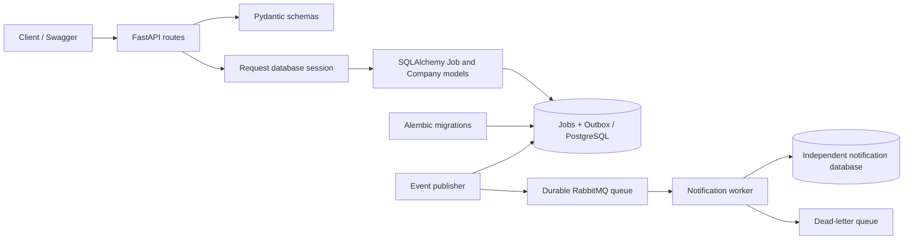
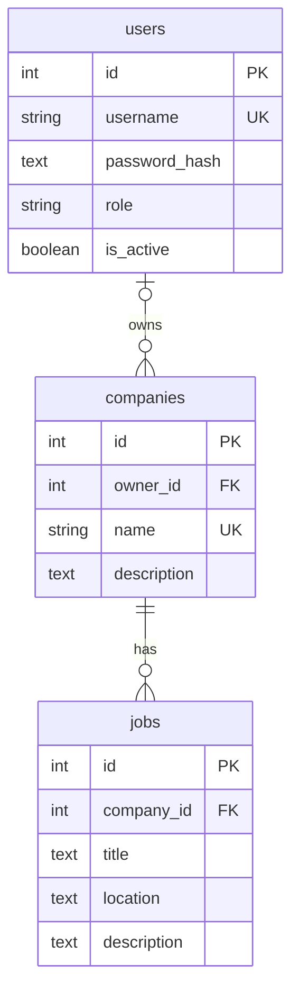

# WorkWise

A Python backend for managing jobs, built incrementally while learning backend
engineering, database design, testing, and distributed systems.

The Phase 1 checkpoint established a working single FastAPI application with
PostgreSQL persistence. Later checkpoints add bounded job-list pagination,
exact company filtering, and Company CRUD APIs linked to jobs by foreign key.
The project was built from scratch; no Java migration is included.

## Implemented

- Job creation, listing, retrieval, replacement, partial updates, and deletion.
- Job-list pagination with validated limit/offset and deterministic ID ordering.
- Optional exact company filtering, applied before pagination.
- Company creation, paginated listing, retrieval, replacement, partial updates,
  and deletion, with 409 responses for duplicate names or linked-company deletion.
- Required job company IDs, database foreign keys, and backfill of legacy names.
- Optional job descriptions with distinct omitted-field and explicit-null behavior.
- Pydantic input validation and typed response models.
- SQLAlchemy ORM, request-scoped sessions, and database-generated IDs.
- Alembic schema migrations and separate runtime/migration credentials.
- PostgreSQL integration tests with transaction isolation and independent-connection
  commit verification.
- OpenAPI documentation at `/docs`.
- Signup/login with Argon2 password hashing and expiring JWT bearer tokens.
- Member/admin roles, company ownership, and authorization for every write.
- Docker image and Compose stack with an isolated PostgreSQL volume and migration service.
- GitHub Actions for PostgreSQL tests, image build, and HTTP container smoke tests.
- Database/schema readiness at `/ready`, separate from process health at `/health`.
- JSON request logs, server-generated request IDs, and bounded HTTP latency/error metrics.
- Admin-only Prometheus-format snapshots at `/metrics`.
- Transactional outbox for `job.created.v1`, a RabbitMQ publisher, and a separate notification worker/database.
- Confirmed publishing, manual acknowledgements, duplicate handling, bounded retries, DLQ and operator replay.
- Docker failure demos exercised in CI: broker outage, offline worker, database outage and recovery.

Companies have their own table. Jobs store `company_id`; API responses also
include the company's name as read-only `company` text. Create a company first,
then use its returned ID when creating a job. Legacy company names have been
backfilled without changing their case or surrounding whitespace.
See [distributed systems and failure demos](docs/distributed-systems.md) for the event flow and guarantees.
Live cloud deployment is still planned.

## Stack

| Component | Technology |
|---|---|
| Runtime | Python 3.13; verified locally with 3.13.5 |
| API and validation | FastAPI and Pydantic 2 |
| Database | PostgreSQL; verified locally with 17.6 |
| Database access | SQLAlchemy 2 and Psycopg 3 |
| Migrations | Alembic |
| Tests | Pytest and HTTPX/TestClient |
| Security | pwdlib/Argon2 and PyJWT |
| Messaging | RabbitMQ and Pika; separate PostgreSQL notification state |

Direct dependencies are pinned to the versions used locally in
`requirements.txt` and `requirements-dev.txt`. These are not a full transitive
dependency lockfile.

## Architecture





```text
main.py                App and job endpoints
routers/companies.py   Company CRUD endpoints
routers/auth.py        Signup, login, and current-user endpoints
security.py            Password hashing, JWT verification, and ownership checks
observability.py       Request context, JSON logs, and HTTP metrics middleware
manage_users.py        Local administrator creation command
schemas.py             Request and response models
models.py              SQLAlchemy table mappings
database.py            Shared engine and session dependency
settings.py            Environment configuration
migrations/            Versioned schema changes
tests/                 API, transaction, and persistence tests
docs/                  Database, migration, and testing notes
check_db.py            Read-only database connection check
baseline_db.py         Historical initial-schema adoption helper
Dockerfile             Non-root Python API image
compose.yaml           Isolated database, migrations, API, and admin tool
scripts/               Docker credential generation, migration runner, CI smoke test
.github/workflows/     PostgreSQL regression tests and container verification
```

## Docker setup

Install/start Docker Desktop with Linux containers first. On a fresh clone,
generate a separate private configuration once, then start the stack:

```powershell
python scripts/create_docker_env.py
docker compose --env-file .env.docker up --build --detach --wait
```

If `.env.docker` already exists, run `python scripts/create_docker_env.py --add-missing`
to append new broker/worker keys while preserving existing credentials.
Docker uses separate database volumes, independent of the native
PostgreSQL setup below. Existing local jobs are not copied into it. Your native
API can keep using port 8000; Docker docs are at <http://127.0.0.1:8001/docs>.

Compose waits for PostgreSQL health, runs migrations and runtime grants, then
starts the API as UID 10001. The API receives runtime credentials only; migration
credentials are restricted to operator services. To create a Docker admin:

```powershell
docker compose --env-file .env.docker run --rm admin
```

The tool privately prompts for a password for `workwise_admin`. Signup/Authorize
also work normally for members in this fresh stack. To stop while retaining data:

```powershell
docker compose --env-file .env.docker down
```

Keep `.env.docker` together with the volume: initialization passwords only apply
when the PostgreSQL volume is empty. See [Docker and CI notes](docs/docker-ci.md)
for upgrades, isolation, and verification details.

## Local setup

The examples below use Windows PowerShell. Install Python and a running
PostgreSQL server first.

```powershell
git clone https://github.com/zsklav/workwise.git
cd workwise
python -m venv .venv
.\.venv\Scripts\Activate.ps1
python -m pip install -r requirements-dev.txt
Copy-Item .env.example .env
```

Edit `.env` locally with your database passwords. `DB_USER` is the runtime user;
`MIGRATION_DB_USER` is the schema-management user. `.env` is ignored by Git.
Generate a signing secret locally and put it in `JWT_SECRET` in `.env`:

```powershell
python -c "import secrets; print(secrets.token_urlsafe(48))"
```

Keep this value private and stable across restarts. The API rejects missing,
short, or example placeholder secrets. Access tokens expire after 30 minutes
by default (`ACCESS_TOKEN_EXPIRE_MINUTES`). Migration commands do not require
the JWT configuration.

### Fresh PostgreSQL databases

These commands are for a new local installation. If you already have the
WorkWise databases and roles, keep them and skip their creation.

Open `psql` as the PostgreSQL administrator, connected to the `postgres` database.
If `psql` is not on PATH, use its full installation path. For PostgreSQL 17:

```powershell
& "C:\Program Files\PostgreSQL\17\bin\psql.exe" -h localhost -p 5432 -U postgres -d postgres
```

Run these inside `psql`, setting passwords interactively:

```sql
CREATE ROLE workwise_app LOGIN;
\password workwise_app
CREATE ROLE workwise_migrator LOGIN;
\password workwise_migrator

CREATE DATABASE workwise OWNER workwise_migrator;
CREATE DATABASE workwise_test OWNER workwise_app;
\connect workwise

GRANT CONNECT ON DATABASE workwise TO workwise_app;
GRANT USAGE ON SCHEMA public TO workwise_app;
GRANT USAGE, CREATE ON SCHEMA public TO workwise_migrator;
```

Exit with `\q`. After filling both passwords in `.env`, run migrations from
PowerShell:

```powershell
python -m alembic upgrade head
python -m alembic current
python -m alembic check
```

Then reconnect as the administrator to `workwise` and grant runtime access
to the newly created tables:

```sql
GRANT SELECT, INSERT, UPDATE, DELETE ON TABLE public.jobs TO workwise_app;
GRANT SELECT, INSERT, UPDATE, DELETE ON TABLE public.companies TO workwise_app;
GRANT SELECT, INSERT ON TABLE public.users TO workwise_app;
GRANT SELECT ON TABLE public.alembic_version TO workwise_app;
GRANT SELECT, INSERT, UPDATE ON TABLE public.outbox_events TO workwise_app;
```

An existing manually created schema needs review and a matching baseline before
upgrades. Do not blindly stamp an unknown database. `baseline_db.py` documents
the project's original adoption of revision `0001`; it is not a generic reset
or initialization command. See [migration notes](docs/migrations.md).

### Start the API

```powershell
python -m uvicorn main:app --reload --no-access-log
```

- API docs: <http://127.0.0.1:8000/docs>
- Health: <http://127.0.0.1:8000/health>
- Jobs: <http://127.0.0.1:8000/jobs>

`--reload` is for local development. Database rows persist across app restarts.
`--no-access-log` avoids duplicate raw URL logs; WorkWise emits its own JSON
request records without query strings, credentials, or bodies. Docker already
uses this flag. Responses include a new `X-Request-ID` that matches their log.

## API

Health and job/company reads are public. All job/company writes require a
bearer token. Members manage their own companies and those companies' jobs;
admins may manage any company/job. Missing/invalid credentials return 401;
authenticated callers without permission receive 403. Moving a job requires
permission on both its current company and destination company.

| Method | Path | Purpose | Success |
|---|---|---|---|
| GET | `/health` | Process health | 200 |
| GET | `/ready` | Database reachable and at the expected schema revision | 200 |
| GET | `/metrics` | Prometheus HTTP metrics; admin bearer token required | 200 |
| GET | `/jobs` | List a page of jobs in ID order | 200 |
| GET | `/jobs/{job_id}` | Retrieve a job | 200 |
| POST | `/jobs` | Create a job | 201 |
| PUT | `/jobs/{job_id}` | Replace editable job fields | 200 |
| PATCH | `/jobs/{job_id}` | Update supplied fields only | 200 |
| DELETE | `/jobs/{job_id}` | Delete a job, no response body | 204 |
| POST | `/companies` | Create a company with a unique name | 201 |
| GET | `/companies` | List a page of companies in ID order | 200 |
| GET | `/companies/{company_id}` | Retrieve a company | 200 |
| PUT | `/companies/{company_id}` | Replace editable company fields | 200 |
| PATCH | `/companies/{company_id}` | Update supplied company fields | 200 |
| DELETE | `/companies/{company_id}` | Delete a company with no jobs | 204 |
| POST | `/auth/signup` | Register a member using JSON username/password | 201 |
| POST | `/auth/login` | Exchange password-grant form credentials for a JWT | 200 |
| GET | `/auth/me` | Return the authenticated user | 200 |

### Sign in through Swagger

1. Use `POST /auth/signup` with a username and password. Usernames are normalized
   to lowercase and allow 3–50 letters/digits/underscores. Passwords must contain
   15–128 characters. Signup always creates a member; role/owner fields are rejected.
2. Click **Authorize** in `/docs`, enter that username/password, and authorize.
   Swagger calls `/auth/login` using form fields and `grant_type=password`.
3. Call `/auth/me`, create your company, then create jobs using its ID. Company
   ownership is assigned by the server. Public responses do not expose owner IDs.

For direct clients, `/auth/login` accepts form data rather than a JSON body:
`grant_type=password`, `username`, and `password`. Send the returned token as
`Authorization: Bearer <access_token>`. The token response includes `expires_in`.

### Existing data and administrator access

Migration 0005 preserves existing jobs/companies with unassigned company owners.
Only admins may manage those legacy records. Signup cannot claim a legacy
company or grant admin privileges. To create your first admin locally:

```powershell
python manage_users.py create-admin workwise_admin
```

The command uses migration credentials, prompts privately for a password and
confirmation, and creates a new admin username. It never promotes an existing
signup or prints/stores a plaintext password. Log in with that admin through
Swagger to manage legacy data. See [authentication and authorization](docs/auth.md).

### Job and company bodies

First create a company using `POST /companies` (example below), or retrieve
one using `GET /companies`. Use its actual returned ID in this `POST /jobs` body:

```json
{
  "title": "Python Backend Intern",
  "company_id": 1,
  "location": "Remote",
  "description": "Build APIs using FastAPI and PostgreSQL"
}
```

Missing jobs return `404` with `{"detail": "Job not found"}`. Invalid inputs
return `422`. Title and location must be nonempty strings. `company_id` must
be a positive JSON integer referring to an existing company; a nonexistent
company returns `404` with `{"detail": "Company not found"}`. Description may
be omitted or null. Responses include both `company_id` and the current company
name as `company`.

PUT requires title, company_id, and location; omitting description clears it.
PATCH preserves omitted fields. `{"description": null}` clears description;
explicit nulls for title/company_id/location and unknown keys are rejected.
An empty PATCH body leaves an existing job unchanged.

This checkpoint intentionally changes job write requests: the old `company`
text key is rejected with `422`, including when supplied alongside `company_id`.
POST and PUT now also reject unknown fields. PATCH can move a job to another
existing company by supplying only its `company_id`.

`GET /jobs` accepts `limit` (default 20, minimum 1, maximum 100) and `offset`
(default 0, minimum 0). Example: `/jobs?limit=2&offset=1` skips the first row
and returns up to two jobs. Offsets count rows, not job IDs. The response
remains a JSON array. Invalid pagination values return 422; an offset beyond
the available rows returns an empty array. The default response is now bounded
at twenty rows, so clients must request subsequent pages for larger datasets.

Add `company` for an exact, case-sensitive company-name filter, for example
`/jobs?company=WorkWise&limit=2&offset=1`. Filtering happens in PostgreSQL before
pagination: offset counts matching rows. Omit company for all companies, or
receive an empty array if nothing matches. `company=` is invalid (422). Quotes,
percent signs, and underscores are treated as literal characters, not SQL or
wildcard syntax. Company values are passed as bound SQL parameters.

Filter directly by ID with `/jobs?company_id=1`. The ID must be positive; an
unknown ID produces an empty list. If both `company` and `company_id` are
supplied, both must match. Both filters run before pagination.

Example `POST /companies` body:

```json
{
  "name": "WorkWise",
  "description": "A job management platform"
}
```

Company names must contain a non-whitespace character and be at most 200
characters. Names are case-sensitive and are not trimmed. Description is
optional; unknown request keys are rejected. An identical name returns `409`
with `{"detail": "Company name already exists"}`. Missing companies return
`404`; invalid input returns `422`. Company lists accept the same pagination
bounds as job lists. Creating a company does not create jobs. PostgreSQL
rejects deleting a company while jobs reference it; deleting a job keeps its
company. `DELETE /companies/{company_id}` returns `409` with
`{"detail": "Company has jobs and cannot be deleted"}` while any jobs remain
linked. Otherwise it returns an empty `204` response. Missing companies return 404.

Company PUT requires `name`; description defaults to null, clearing an omitted
description. PATCH preserves omitted fields, accepts `{"description": null}`
to clear description, and rejects explicit null for name. An empty PATCH is a
no-op for an existing company. Both reject invalid names and unknown fields.
Renaming to an existing exact name returns 409 without changing either field.
Renaming a company keeps its ID and jobs' company IDs unchanged; job responses
and name filters immediately use the new name on subsequent requests.
See [Company notes](docs/companies.md).

## Tests

```powershell
python -m pytest -v
```

Tests explicitly use `workwise_test`, applying Alembic migrations through a
shared test connection before running. The runtime role owns this separate test
database, enabling test setup without widening its development permissions.
The users, companies, jobs, and outbox tables must start empty; existing rows are not silently deleted.

Most cases roll back their changes, including ORM commits through savepoints.
Separate persistence cases use real commits, check independent connections,
and remove only their uniquely marked test rows. Tests are designed for sequential
execution, not parallel workers.

Last verified local checkpoint: **233 tests passed** on 2026-10-21. The learner also
verified that a created job remains available after restarting Uvicorn.

GitHub [CI runs](https://github.com/zsklav/workwise/actions/workflows/ci.yml) on
pushes/PRs to main and manual dispatch. One job tests a fresh PostgreSQL setup;
another builds the image, verifies HTTP, and exercises broker/worker failure recovery.
No image publication or live deployment occurs in this workflow.

## Observability

Authorize as an admin in Swagger, then call `GET /metrics`. Anonymous callers
receive 401 and members receive 403. The endpoint returns request counters,
latency histograms, and unhandled-error counters as Prometheus text.

Labels use route templates such as `/jobs/{job_id}`, never actual IDs, users,
request IDs, or query values. Unknown routes share one label. JSON request logs
include timestamp, request ID, method, route, status, duration, completion flags,
and exception type where applicable. Unexpected errors before response headers
return generic 500 JSON and a request ID rather than exception details.

This is an exporter/logging foundation. Counters are in memory per process and
reset on restart; no Prometheus server, Grafana, alert rules, or external log
storage is deployed. Metrics use the existing expiring admin JWT for manual
inspection; continuous scraping needs a later service-auth design. See
[observability details](docs/observability.md).

## Current scope and next steps

This is a learning checkpoint, not a production deployment. Signup/login and
ownership checks are implemented. Refresh tokens, password reset, login rate
limits, and version-based concurrency conflict detection remain future work.
Offset pagination is intended for this initial stage;
large offsets and changes between page requests need later evaluation.

Docker, CI, transactional messaging and failure recovery demos are implemented.
Next: live deployment when a hosting target is selected, followed by external
notification delivery, retention/monitoring and distributed tracing as needed.

## Engineering notes

- [Database behavior and API contracts](docs/database.md)
- [Company APIs and database constraints](docs/companies.md)
- [Authentication, roles, and ownership](docs/auth.md)
- [Docker runtime and CI](docs/docker-ci.md)
- [Distributed events, guarantees and failure demos](docs/distributed-systems.md)
- [Request logs, IDs, and metrics](docs/observability.md)
- [Migration history and baseline verification](docs/migrations.md)
- [Testing setup, guarantees, and limitations](docs/testing.md)
