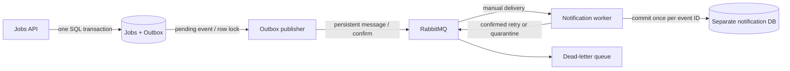

# Distributed event processing

WorkWise remains one repository. API, publisher, RabbitMQ, worker, and notification
database run as independent processes/containers. Job creation emits a recipient
event and delivers an **in-app inbox notification**. A separate internal API serves
the caller's inbox through the main authenticated API; no external email is sent.
See [inbox and tracing](notifications-tracing.md) for the current workflow and rollout.



## Failure and consistency model

| Boundary | Behavior |
|---|---|
| Job insert + outbox insert | Same PostgreSQL transaction; either both commit or neither commits. No broker call in HTTP request. |
| Broker offline | API can still create jobs. Publisher reconnects and retries pending rows. |
| Concurrent publishers | `FOR UPDATE SKIP LOCKED` claims one pending row per transaction. |
| Publisher confirmation | `published_at` is set only after mandatory publish succeeds in confirm mode. |
| Crash after confirm, before database commit | Event can be published twice with the same UUID. |
| Worker offline | Durable queue retains persistent messages. Worker drains it after restart. |
| Worker commit before lost ACK | Broker can redeliver; primary-key deduplication prevents a second receipt. |
| Same UUID with different payload | Conflict goes to DLQ; original receipt is preserved. |
| Transient notification DB failure | Three confirmed republished retries, with 1/2/4-second heartbeat-aware delays, then DLQ on the fourth failed attempt. |
| Malformed/unsupported event or mismatched message ID | Directly quarantined in DLQ without a receipt. |
| Retry/DLQ publish fails | Original remains unacked and is requeued when connection closes. |
| Recovery after retries exhausted | Explicit operator replay of the selected valid DLQ event; resets retry header. |

This is **at-least-once delivery with idempotent database effects**, not end-to-end
exactly-once delivery. The event envelope contains a UUID, event type/version,
UTC timestamp, job ID, company ID and (in v2) recipient user ID. No credentials or personal contact data
are included. IDs are a historical reference: receipts do not query or foreign-key
the jobs database, and events survive later job/company deletion.

Worker state is a separate PostgreSQL service/volume and independently versioned
schema (`notification_schema_version = 2`). Its runtime role can only select/insert
receipts/inbox rows and read that version; it cannot create tables or update/delete rows.
`docker/notifications/init.sh` initializes a fresh notification volume at v1;
`notification-migrate` upgrades it to v2 and grants the separate inbox API role.
Jobs Alembic never manages this database. API and publisher share the jobs runtime role for now;
publisher has no JWT/migration credentials. Worker receives no jobs DB/JWT/admin
credentials. Broker credentials are shared by the two trusted background services;
per-service RabbitMQ permissions remain a later hardening step.

The broker uses durable classic queues and a named volume. Persistent messages,
[publisher confirms and consumer acknowledgements](https://www.rabbitmq.com/docs/confirms)
cover different boundaries. This stack has **one broker node**, not broker HA;
deleting its volume or losing the disk can lose queued events. The outbox history
is retained, but automatic recovery of already-published rows after storage loss
is not implemented. There is no global event order, distributed transaction,
automatic failover, outbox retention job, autoscaling, or cross-service query yet.
Delivery order may change across retries or multiple publishers/workers.

## Start or upgrade the Docker demo

Docker Desktop's Linux engine must be running. The native API may remain on 8000;
Docker uses 8001 and separate database volumes.

```powershell
python -m scripts.docker.create_env --add-missing
docker compose --env-file .env.docker up --build --detach --wait --wait-timeout 180
docker compose --env-file .env.docker logs --follow publisher notification-worker
```

The helper creates a fresh config if absent and appends missing keys if present;
existing passwords are preserved. Normal `up` applies revision 0006 and runtime
outbox grants without deleting jobs. For controlled existing-stack upgrades,
stop `api`/`publisher`/`notification-worker`, build, run `migrate`, then run `up`.
No native RabbitMQ installation is required. A native-only API also stores events,
but they remain pending until a publisher is configured for that database.
Compose health checks cover API/database/broker startup and background process
loop heartbeats. Publisher/worker update a temporary heartbeat file as their
loops run; a file older than 45 seconds fails their health check. This is not an
end-to-end delivery check or alerting system; the demo verifies event processing.

RabbitMQ management is at <http://127.0.0.1:15672> (username `workwise`, password
from your private `.env.docker`). Queue names are `workwise.notifications.v1`
and `workwise.notifications.dead.v1`. No database or AMQP host port is exposed.

## Reproducible interview/demo checks

On a **disposable demo stack**, run:

```powershell
python -m scripts.smoke.distributed --allow-service-interruption
```

This intentionally stops/restarts the worker, broker and notification database.
It creates uniquely named demo data, verifies pending/queued events, recovery,
duplicate delivery, bounded retries, poison quarantine and valid-event replay.
It restores stopped services in a `finally` block and retains volumes and demo
records. GitHub Actions runs it on its disposable stack after the HTTP smoke test.
Do not run this interruption script on a shared or production environment.

To inspect without stopping services:

```powershell
docker compose --env-file .env.docker exec db psql -U postgres -d workwise -c "SELECT id, payload, published_at FROM outbox_events ORDER BY created_at DESC LIMIT 10"
docker compose --env-file .env.docker exec notification-db psql -U postgres -d notifications -c "SELECT * FROM notification_receipts ORDER BY recorded_at DESC LIMIT 10"
```

After fixing a failed dependency, replay one **valid** event selected from the
DLQ. Replace the example UUID with its real event ID:

```powershell
docker compose --env-file .env.docker exec publisher python -m workwise.messaging.replay --event-id 00000000-0000-0000-0000-000000000000
```

Replay scans at most 100 ready DLQ messages (adjust `--limit` up to 1000), publishes
the selected valid event with confirmation before ACK, and leaves other messages
in the DLQ. Invalid envelopes need investigation/correction, not blind replay.
Concurrent operators/replays can produce duplicates, which the receipt key handles.

Stop with `docker compose --env-file .env.docker down` to retain all three data
volumes. The CI runner alone removes its disposable volumes after validation.
