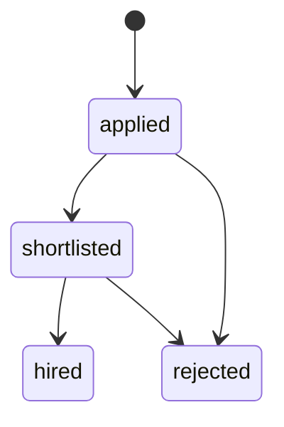

# Safe client retries and job applications

## Idempotent creation

These two endpoints accept an optional `Idempotency-Key` header:

- `POST /jobs`
- `POST /jobs/{job_id}/applications`

```http
POST /jobs
Authorization: Bearer <access token>
Idempotency-Key: create-job-550e8400-e29b-41d4-a716-446655440000
Content-Type: application/json

{"title":"Backend engineer","company_id":1,"location":"Remote"}
```

A successful first call returns `201` and `Idempotency-Replayed: false`. A retry
from the same authenticated user, with the same operation/path, key and validated
payload, returns the stored `201` body and `Idempotency-Replayed: true`. Both use
`Cache-Control: no-store`. Keys contain 1–128 ASCII letters, digits, `.`, `_`, `:`
or `-`. Raw keys are hashed before storage and are not returned in error details.

The reservation window lasts 24 hours, measured by PostgreSQL. A changed payload
with an unexpired matching key returns `409`; another user or operation has its own
scope. Normalized validated bodies are hashed, so an omitted optional description
and an explicit `null` mean the same job-creation request. No whitespace/content
normalization is applied to job text. Without a key, repeated job POSTs create
separate jobs. Identical content does not prove identical user intent.

The recorded body is the **original creation response**, including its original
version. Editing or deleting the resource does not change the snapshot. Fetch the
resource to see its current state. Expired keys may be reused for a new creation;
application uniqueness still forbids the same applicant applying twice to one job.

`workwise/api/idempotency.py` reserves `(user_id, scope, key_hash)` using PostgreSQL
`INSERT ... ON CONFLICT`. A concurrent caller waits for the winner's transaction.
The key reservation, new row, response snapshot and outbox event all commit or
roll back together. There is no separately committed "in progress" record. Failed
authorization, validation or event persistence does not consume a key. Lock waits
are bounded at five seconds; a lock/statement timeout returns `409` with
`Retry-After: 1`, allowing the client to retry the same request/key. Other requests
on other keys are independent.

This works across API instances because the uniqueness and response snapshot live
in the shared jobs database. It guarantees one creation effect for a successfully
recorded request in its window; broker delivery remains at least once. Response
snapshots can contain private application letters. Operator cleanup of expired
records is preview-first and bounded:

```powershell
docker compose --env-file .env.docker run --rm --no-deps retention-outbox python -m workwise.operations.retention idempotency --days 7
# Add --apply after reviewing the preview.
```

The 24-hour window is an eligibility rule, not immediate physical deletion.
Unused expired records remain until maintenance runs; the command above keeps
records for another seven days after expiry. Reusing an expired key replaces its
previous snapshot in the same transaction. No automatic cleanup schedule is installed.

## Application workflow

An authenticated user applies to another company's job with:

```http
POST /jobs/1/applications
Authorization: Bearer <applicant access token>
Idempotency-Key: apply-job-1-unique-intent
Content-Type: application/json

{"cover_letter":"I have built and tested Python backend services."}
```

The API assigns the applicant from the authenticated identity. Clients cannot
supply an applicant ID, initial state or version. Letters are optional and limited
to 4,000 characters; validation errors redact body inputs. A database unique
constraint permits one application per `(job_id, applicant_id)`, including after
rejection/hiring. An owner cannot apply to their own company's job.

| Endpoint | Access |
|---|---|
| `GET /applications/mine` | Only the caller's applications |
| `GET /jobs/{job_id}/applications` | Company owner or admin |
| `GET /applications/{id}` | Applicant, company owner or admin; outsiders receive 404 |
| `PATCH /applications/{id}` | Company owner or admin |

Lists accept `limit` (default 20, max 100), `offset` and an optional exact `status`.
Ordering is ascending application ID. Application responses are private and use
`Cache-Control: no-store`; public job reads do not expose letters or applicant lists.



Review bodies contain the last observed positive integer `version` and the desired
state. Applied → hired, backwards transitions, repeated states and changes to a
terminal state return `409`. Each successful transition increments the version.
SQLAlchemy's version predicate makes a concurrent stale review fail atomically;
the losing transaction creates no outbox event. The applicant cannot review their
own application. Example owner review:

```http
PATCH /applications/1
Authorization: Bearer <company owner access token>
Content-Type: application/json

{"version":1,"status":"shortlisted"}
```

Application records are retained as history; there is no public deletion,
withdrawal or reapplication endpoint. The database prevents deleting a job with
applications, and the API returns `409`. A job with applications cannot move to
another company; a job-row lock serializes company transfers against new applications.
Other job edits remain version-checked and available. Applications refer to the
live job rather than keeping a complete historical copy of its title/description.

## Notifications and rollout

Creation and each state transition append an `application.changed.v1` event in
the same transaction. It includes application ID/version, status, job/company IDs,
recipient ID, event UUID and occurrence time. It excludes letters and credentials.
The recipient is the applicant, including the initial application confirmation.
Employers review candidate lists through the owner API.

The existing publisher and worker deliver these events to the applicant's inbox.
A receipt and inbox item still commit together, and repeated event IDs produce
no additional inbox rows. Job v1/v2 event compatibility remains. Parallel publishers
and workers do not guarantee application-event arrival order; the application's
current version/state in PostgreSQL is authoritative. Inbox entries are independent
notifications, not a projection used to overwrite application status.

Migration `0011` adds the two tables and indexes without modifying existing rows.
The migration runner grants runtime SELECT/INSERT/UPDATE on them, with no runtime
DELETE or DDL privilege. Backup inventory includes both tables. Downgrading `0011`
would remove application/idempotency history; only use it in a reviewed recovery.
For a staged rollout, upgrade workers to accept the new event type before enabling
new application writers. The Docker demo builds matching code for every instance.

Tests cover retries, changed bodies, expiry, user scoping, rollback, authorization,
input privacy, transitions, pagination, job protection, migration round trips,
retention and independent concurrent connections. Docker CI exercises both APIs
and delivery with the primary API/publisher/worker stopped.

References: [AWS's idempotent API design](https://aws.amazon.com/builders-library/making-retries-safe-with-idempotent-APIs/)
and [SQLAlchemy PostgreSQL upserts](https://docs.sqlalchemy.org/en/20/dialects/postgresql.html#insert-on-conflict-upsert).
