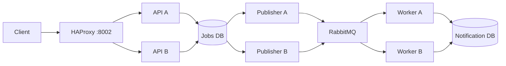

# Multiple-instance failure demonstration

The optional `scale` Compose profile adds a second public API, outbox publisher,
notification worker, and an HAProxy gateway. All instances use the same image and
their existing service-specific credentials. Replicas share the jobs database,
notification database and broker rather than copying process-local state.



## Start and inspect

After generating the private Docker configuration, run:

```powershell
docker compose --env-file .env.docker --profile monitoring --profile scale up --build --detach --wait
```

The original API remains at `http://127.0.0.1:8001`; the gateway is at
`http://127.0.0.1:8002/docs`. The API replica publishes no host port. The demo-only
`X-WorkWise-Backend` response header identifies `api-a` or `api-b`, making routing
observable. HAProxy uses round-robin routing and `/ready` checks every second.
Two failed checks remove an instance; one passing check restores it. Docker DNS
is refreshed for service recreation. Existing in-flight requests can still fail;
clients retry creation with their original idempotency key.

The gateway retries connection establishment and can redispatch it. It does not
automatically replay POSTs based on HTTP error responses. APIs keep proxy-header
trust disabled. Behind this gateway, per-IP auth limits see a shared gateway peer;
per-account limits remain separate. This is a bounded local demo rather than a
production ingress/trusted-client-IP design.

## Run the failure scenario

Only on the disposable stack:

```powershell
python -m scripts.smoke.scale --allow-service-interruption
```

The executable demo:

1. Starts the extra instances and gateway.
2. Sends 16 concurrent same-key job POSTs through both APIs. All return the same
   creation body; exactly one job/outbox event is stored and one response is fresh.
3. Verifies two broker consumers, then stops primary API, publisher and worker.
4. Waits for health-based routing to the surviving API and creates another job.
5. Applies as a separate user, rejects applicant self-review, shortlists and hires
   as the employer, and rejects a stale review.
6. Waits for all three application events to reach the applicant's private inbox
   through the surviving publisher/worker.
7. Republishes the same event ID, then uses a marker event to prove the remaining
   worker drained the duplicates without creating duplicate inbox entries.
8. Stops extra writers and restarts primary instances in `finally`.

The demo retains uniquely named synthetic jobs/accounts/applications in its
disposable databases. Application history intentionally prevents public deletion
of those jobs. Remove disposable volumes when finished; do not run this smoke
test on personal or production data. CI runs it before the paired backup drill,
with replicas stopped so the backup drill's writer pause remains complete.

## Guarantees and limits

Idempotency lives in PostgreSQL's unique key and transaction; version checks
also use database predicates. Neither relies on sticky sessions or one API
process. Concurrent publishers claim outbox rows using `FOR UPDATE SKIP LOCKED`.
Workers acknowledge only after a durable receipt/inbox commit, with a receipt
primary key preventing duplicate database effects. Delivery remains at least
once, and independent events can arrive out of order.

This demonstrates process failure recovery on **one host**. The gateway, broker,
each database and host are still single failure points. There is no database
replication, broker cluster, Kubernetes deployment, autoscaling or production
availability SLA. Existing monitoring covers the primary service targets; replica
HTTP metrics are separate process-local counters, not an automatically aggregated
fleet dashboard. Native Windows validation uses PostgreSQL; actual HAProxy and
multi-container behavior are checked on GitHub's Linux runner.

To remove all disposable containers and volumes, including scale services:

```powershell
docker compose --env-file .env.docker --profile monitoring --profile scale down --volumes
```

References: [HAProxy 3.2 configuration](https://docs.haproxy.org/3.2/configuration.html),
[idempotency/application contracts](idempotency-applications.md), and
[messaging guarantees](distributed-systems.md).
