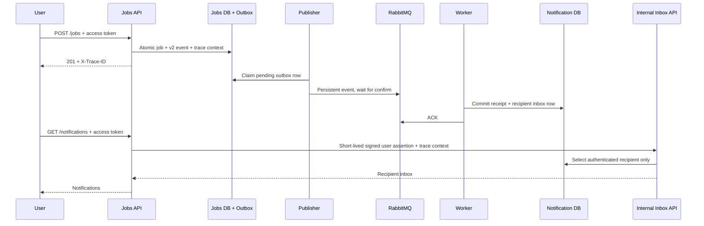

# Recipient inbox and distributed tracing

Creating a job now delivers an **in-app notification to the authenticated user who
created it**. An admin creating a job for someone else's company receives their
own confirmation. There is no broadcast, email provider, subscriber list or
external message send in this workflow.

## Public endpoints

Authorize with the existing access token in the main Swagger UI.

| Method | Endpoint | Behavior |
|---|---|---|
| GET | `/notifications?limit=20&offset=0&unread_only=true` | Only the caller's inbox; newest first, UUID tie-breaker. Limit 1–100, offset >= 0. |
| PATCH | `/notifications/{event_id}/read` | Marks the caller's notification read. Repeating preserves the first timestamp. No body required. |

Missing/invalid login returns 401. Missing notifications and another user's
notification both return 404. Even admins can only read their own inbox. Responses
contain event/job/company IDs, message, event/delivery timestamps, and nullable
`read_at`; recipient IDs are not exposed. Successful inbox responses are
`Cache-Control: no-store`. No request parameter can select another recipient.

Delivery is asynchronous: POST `/jobs` returns 201 after committing the job and
outbox, so its notification may appear a little later. Inbox reads need the
notification API/database; failure returns a generic 503. Job writes and event
delivery continue while the inbox HTTP service is offline.



## Data and compatibility

New `job.created.v2` events require a positive `recipient_id` derived from the
authenticated user, never from the request body. The v1 schema remains accepted
by consumers/replay. Legacy v1 events contain no reliable recipient: they retain
their receipt-only behavior and are not assigned to arbitrary users.

Worker receipt and inbox inserts share one notification-database transaction.
If inbox insertion fails, the receipt rolls back too. Duplicate UUIDs with the
same payload create one inbox row; changed payloads with a reused UUID are
quarantined. Event snapshots survive later job/company deletion, so a notification
may refer to a resource that no longer exists.

The main API never connects to notification storage. It authenticates the active
user against its own database, then calls the internal notification API using a
separate 30-second HS256 token with fixed issuer/audience and `type=internal`.
Normal public access tokens are not accepted by the internal service. Requests
have a 2-second connect timeout and 5-second HTTP operation timeout, do not follow
redirects, and validate upstream response contracts. No synchronous retries are
added to user inbox requests.

The internal service has no published host port. Its database role can SELECT
notifications and UPDATE only `read_at`; worker credentials permit SELECT/INSERT
but no updates/deletes. Neither service receives jobs DB credentials or the public
JWT secret. The API/internal service share only a separate signing secret.

## Schema upgrades and rollout

Jobs Alembic revision **0007** adds nullable `outbox_events.trace_context`; existing
rows remain valid. Notification migration **v2** adds the inbox table/index and a
separate API role, preserves all v1 receipts, and is repeatable. This is managed
by `notification-migrate`, independently of jobs Alembic. Passwords are created
only when the API role is absent; changing an env value does not rotate an existing
role's password. The initial database bootstrap remains schema v1, so fresh and
existing volumes both use the same v1-to-v2 migration.

For an existing Docker stack, keep volumes and current credentials:

```powershell
python scripts/create_docker_env.py --add-missing
docker compose --env-file .env.docker stop api publisher notification-worker notification-api
docker compose --env-file .env.docker build
docker compose --env-file .env.docker run --rm migrate
docker compose --env-file .env.docker run --rm notification-migrate
docker compose --env-file .env.docker up --detach --wait --wait-timeout 180
```

Stop old API/consumers during this local upgrade: the old worker rejects v2 events.
The upgraded worker understands both versions. No volume reset is needed.

The Compose stack is the complete demo. The native-only API keeps its existing
database and can create v2 events, but `/notifications` returns 503 until a paired
notification service URL/signing secret is configured. Native and Docker users/
databases are independent; use Docker's own signup/login to demonstrate its inbox.

## Traces and logs

Docker enables `OTEL_EXPORTER_OTLP_TRACES_ENDPOINT=http://jaeger:4318/v1/traces`.
Without that environment variable, SDK/exporter setup is skipped. The middleware
uses route templates and method/status, not raw paths, query values, bodies,
authorization headers or exception messages. Only W3C `traceparent`/`tracestate`
are propagated; baggage is not forwarded. Malformed trace parents start a new
trace. Valid incoming trace/sample context is respected.

Trace context is persisted **beside** the immutable event payload in the outbox,
then injected into AMQP headers. Retries and operator replay preserve trace
continuity. API responses include `X-Trace-ID` when tracing is active. HTTP JSON
logs and worker processing logs include the current trace ID. Publisher logs after
the publish span closes retain event ID for correlation.

Open <http://127.0.0.1:16686> and search service `workwise-api`, or look up the
response's trace ID. A job trace contains `POST /jobs`, `outbox.publish` and
`notifications.process` across three service names. An inbox read has the API's
HTTP/client spans and the internal notification API's server span.

Jaeger uses transient in-memory storage in this demo. Restarting it clears traces;
business databases are unaffected. Export runs in a bounded background batch
queue; collector outages do not roll back jobs/notifications and traces may be
dropped. This is neither durable audit storage nor a deployed monitoring/alerting
system. There is no automatic SQL instrumentation or body/header capture.

## Verification

```powershell
python -m pytest -q --tb=short
python scripts/notification_smoke.py --allow-service-interruption
```

The second command is for a **disposable Docker demo/CI stack**: it creates two
users, verifies recipient isolation, asynchronous inbox delivery, read idempotency,
and both exported trace chains via Jaeger's query API. It stops/restarts the inbox
API and collector to verify business operations continue, then restores them.
Demo rows/volumes are retained. GitHub Actions runs this after the broker failure
demo. Unit/PostgreSQL cases also cover schema preservation, atomic rollback,
invalid/expired/wrong-audience internal credentials, upstream timeouts/contracts,
redacted trace errors and durable context propagation.

References: [OpenTelemetry Python propagation](https://opentelemetry.io/docs/languages/python/propagation/),
[OTLP exporters](https://opentelemetry.io/docs/languages/python/exporters/),
[Jaeger quick start](https://www.jaegertracing.io/docs/2.22/getting-started/).
